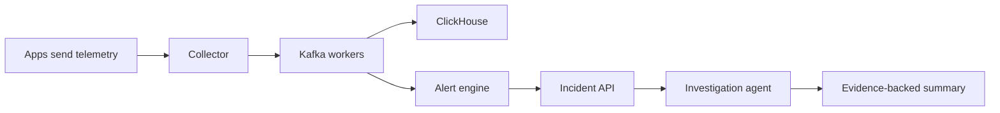

# OpsPilot

**OpsPilot** is an operations assistant for production systems. When something breaks, it should **detect** the problem, **open an incident**, **dig through real logs and metrics**, and give engineers an **evidence-backed** explanation—not a guess.

> **Design principle:** The AI must investigate actual data and cite evidence. Plausible stories without proof are out of scope.

---

## Contents

| Section | What you’ll learn |
|---------|-------------------|
| [The problem](#the-problem) | Why this exists |
| [What OpsPilot does](#what-opspilot-does) | Five capabilities at a glance |
| [How it fits together](#how-it-fits-together) | End-to-end flow |
| [Functional requirements](#functional-requirements) | What the system must do (behavior, not just tech names) |
| [Non-functional requirements](#non-functional-requirements) | Performance, security, quality bar |
| [MVP priorities](#mvp-priorities) | What to build first |
| [Services](#services) | The four main components |
| [More docs](#more-docs) | Deeper references |

---

## The problem

Picture an e-commerce app with **user**, **payment**, **order**, **inventory**, and **notification** services.

**At 2:00 PM**, customers report that payments are failing.

A typical on-call engineer today might:

1. Notice an alert or complaint  
2. Open Grafana (or similar)  
3. Search logs across services  
4. Check error rates and latency  
5. Review recent deploys  
6. Correlate events by hand  
7. Hypothesize a root cause  
8. Create and update an incident  
9. Brief the team  

That work is slow when signals live in **different tools**.

**OpsPilot** automates and simplifies parts of that workflow—especially detection, incident tracking, and data-backed investigation.

---

## What OpsPilot does

Five capabilities define the product:

| # | Capability | In plain terms | Example |
|---|------------|----------------|---------|
| 1 | **Data collection** | Pull in logs and metrics from your apps | Payment-service errors arrive in OpsPilot |
| 2 | **Incident detection** | Compare live data to alert rules | Payment failure rate &gt; 10% |
| 3 | **Incident management** | One place to track outages | “Payment Service” incident opened |
| 4 | **AI investigation** | Search logs, metrics, deploy history | Failures started right after a deploy |
| 5 | **Root-cause summary** | Explain what might be wrong, with proof | Summary links to logs and metrics |

---

## How it fits together

High-level path from telemetry to an engineer-ready summary:



**In order:**

1. Services **send** logs/metrics (HTTP).  
2. **Collector** validates and forwards to **Kafka**; data lands in **ClickHouse**.  
3. **Alert engine** evaluates rules and raises alerts.  
4. **Incident API** turns alerts into tracked incidents (OAuth2, teams, audit).  
5. **Investigation agent** uses bounded tools (search logs, query metrics, list deploys) and attaches results to the incident.

Technical building blocks (Kafka, ClickHouse, OAuth2, etc.) are choices for implementation—the **behaviors** below are what matter.

---

## Functional requirements

Requirements are grouped so you can read one area at a time. Terms like *Kafka* or *ClickHouse* name the proposed stack; focus on *what* must happen.

### A. Telemetry: ingest and process

| # | Area | Must do |
|---|------|---------|
| **1** | **Collect logs and metrics** | Accept HTTP telemetry from other apps; reject malformed events; support logs and metrics; require labels (service, environment, time, severity); allow batches; after validation, publish to Kafka and store in ClickHouse. |
| **2** | **Process asynchronously** | Workers consume from Kafka; don’t block APIs; retry sensibly; handle duplicates safely; dead-letter bad events; preserve timestamps and metadata end to end. |

### B. Alerting: rules and evaluation

| # | Area | Must do |
|---|------|---------|
| **3** | **Alert rules** | CRUD rules based on metrics or event counts; threshold + time window; enable/disable; scope by service and environment. |

**Example rule:**

```yaml
name: payment-error-rate
service: payment-service
metric: http_5xx_error_rate
condition: greater_than
threshold: 10
evaluation_window: 5m
severity: critical
```

| # | Area | Must do |
|---|------|---------|
| **4** | **Alert engine** | Continuously evaluate rules; detect firing and recovery; avoid alert spam for one ongoing issue; record service and environment. |

### C. Incidents and API

| # | Area | Must do |
|---|------|---------|
| **5** | **Incidents from alerts** | Auto-open incidents; attach related alerts to one issue; avoid duplicate incidents for one outage; severity and service; lifecycle and timeline; log key actions. |

**Lifecycle:**

```
OPEN → ACKNOWLEDGED → RESOLVED
```

| # | Area | Must do |
|---|------|---------|
| **6** | **Incident API** (Spring Boot) | CRUD/list/filter incidents with linked alerts; acknowledge/resolve; teams and on-call; OAuth2 + RBAC; audit trail. |

### D. AI investigation

| # | Area | Must do |
|---|------|---------|
| **7** | **Controlled data access** | Agent uses defined tools only (no raw DB): search logs, query metrics, list deploys—with limits and timeouts. |
| **8** | **Run investigations** | Start from an incident; load context; correlate logs, metrics, deploys; suggest causes with confidence; separate **observations** vs **hypotheses**; say when evidence is missing. |

**Example investigation output:**

```json
{
  "incident_id": "INC-1001",
  "summary": "Payment API error rate increased significantly.",
  "observations": [
    "HTTP 5xx errors increased from 1% to 35%.",
    "Database timeout errors increased.",
    "A deployment occurred four minutes before the incident."
  ],
  "possible_root_causes": [
    {
      "description": "Database connection handling issue",
      "confidence": "medium",
      "evidence": [
        "Increased database timeout logs",
        "Increased payment API latency",
        "Recent deployment"
      ]
    }
  ],
  "status": "investigation_completed"
}
```

| # | Area | Must do |
|---|------|---------|
| **9** | **Persist results** | On-demand or automated runs; track running/completed/failed; store and revisit history; human review of AI findings. |
| **10** | **Evaluation harness** | Dataset of incidents with known causes; replay tests; measure accuracy and unsupported claims; catch regressions. |

---

## Non-functional requirements

Quality bar for the platform (summarized; full IDs for traceability):

| Theme | IDs | Expectation |
|-------|-----|-------------|
| **Throughput & latency** | NFR-01, NFR-02, NFR-06 | High ingestion (e.g. 50k events/s target), p95 processing within ~2s for alert path, backpressure under spikes |
| **Scale & resilience** | NFR-03, NFR-04, NFR-05, NFR-07 | Horizontal scale; durable queue; survive Kafka/ClickHouse/API blips; idempotent handling |
| **Security & ops** | NFR-08, NFR-09 | OAuth2, RBAC, validation; metrics, logs, health, traces for OpsPilot itself |
| **Engineering** | NFR-10, NFR-11, NFR-14, NFR-15 | Modular services; integrity of events and relationships; automated tests; Docker Compose deploy |
| **AI quality** | NFR-12, NFR-13 | Root causes cite evidence; explicit “insufficient evidence” when needed |

<details>
<summary>Full NFR table (click to expand)</summary>

| ID | Category | Requirement | Proposed acceptance criteria |
|---|---|---|---|
| NFR-01 | Performance | High-throughput ingestion | Target 50,000 events/sec on one machine under a defined benchmark workload. |
| NFR-02 | Latency | Low-latency event processing | 95% of accepted events become available to the alert engine within 2 seconds. |
| NFR-03 | Scalability | Horizontal scalability | Collector and alert engine should support multiple instances. |
| NFR-04 | Reliability | No silent event loss | Accepted events must be durably queued or failures explicitly reported. |
| NFR-05 | Fault tolerance | Handle component failures | Temporary Kafka, ClickHouse, or API failures must not crash the entire pipeline. |
| NFR-06 | Backpressure | Handle traffic spikes | Bounded queues and controlled ingestion when downstream systems are slow. |
| NFR-07 | Idempotency | Prevent duplicate processing effects | Replayed events should not create duplicate incidents. |
| NFR-08 | Security | Protect APIs and data | OAuth2 authentication, RBAC, input validation, and secure service communication. |
| NFR-09 | Observability | Monitor OpsPilot itself | Expose application metrics, structured logs, health checks, and distributed traces. |
| NFR-10 | Maintainability | Modular architecture | Separate ingestion, alerting, incident management, and investigation responsibilities. |
| NFR-11 | Data integrity | Preserve event correctness | Consistent event identifiers, timestamps, and incident relationships. |
| NFR-12 | AI quality | Evidence-backed investigations | Every proposed root cause must reference retrieved evidence. |
| NFR-13 | AI reliability | Avoid unsupported conclusions | Agent must explicitly report insufficient evidence when appropriate. |
| NFR-14 | Testability | Automated verification | Unit, integration, load, failure-injection, and AI evaluation tests. |
| NFR-15 | Deployability | Reproducible deployment | Services should run using Docker Compose with documented configuration. |

</details>

---

## MVP priorities

Build in layers—ship value early, harden later.

| Priority | Build this |
|----------|------------|
| **P0 – Essential** | Ingestion → Kafka → ClickHouse, threshold alerts, incident creation & basic lifecycle, AI investigation with evidence-backed summary |
| **P1 – Important** | OAuth2/RBAC, alert rule APIs, retries, DLQ, audit history, evaluation suite |
| **P2 – Advanced** | 50k/s tuning, horizontal scaling, richer failure recovery, MCP, dashboards |
| **P3 – Stretch** | Auto-remediation, anomaly detection, multi-tenant isolation |

---

## Services

Four deployable components and how they map to the requirements:

| Component | Role | Key NFRs |
|-----------|------|----------|
| **`opspilot-collector`** | Receive, validate, batch, publish telemetry | Throughput, concurrency, backpressure, reliability |
| **`opspilot-alert-engine`** | Consume telemetry, evaluate rules, emit alerts | Low latency, idempotency, scale, fault tolerance |
| **`opspilot-incident-api`** | Incidents, users, teams, schedules, audit | Security, consistency, availability |
| **`opspilot-investigation-agent`** | Investigate using logs, metrics, deploys | Evidence quality, bounded execution, evaluation |

Each service has its own `README.md` in its directory.

---

## More docs

| Document | Purpose |
|----------|---------|
| [`documents/architecture.md`](documents/architecture.md) | System architecture |
| [`documents/event-schema.md`](documents/event-schema.md) | Telemetry event format |
| [`documents/api-contracts.md`](documents/api-contracts.md) | API contracts |